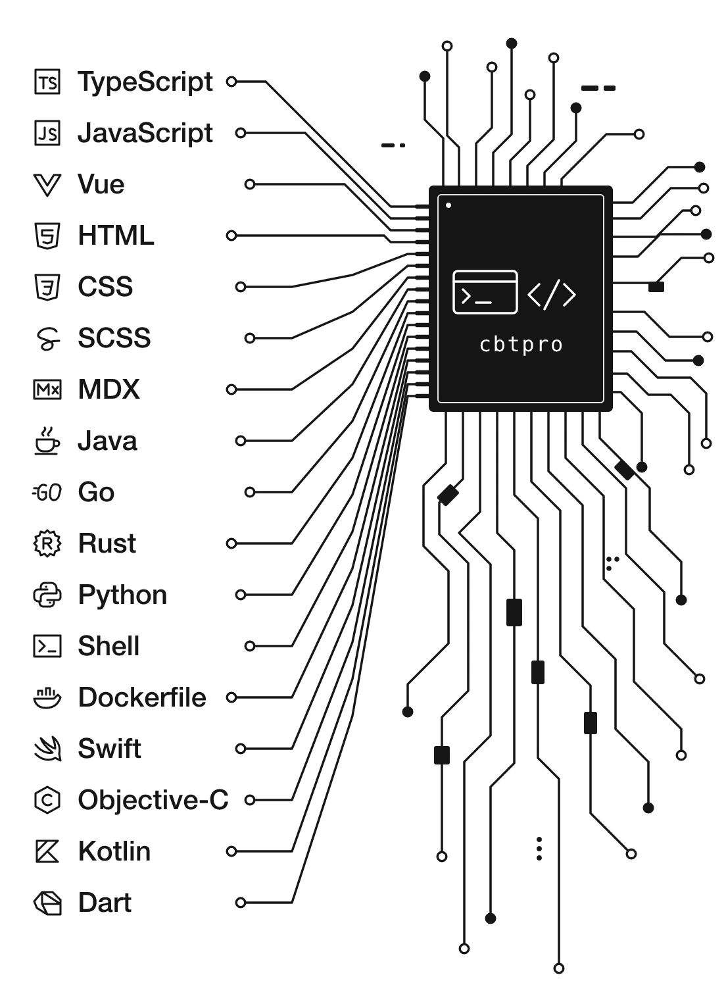

# 陈碧滔 · cbtpro



> Go as far as you can see; when you get there, you’ll be able to see farther.

[技术博客](https://blog.chenbitao.com/) · [掘金](https://juejin.cn/user/905653310988445)

## 项目

- [spring-jekyll-theme](https://github.com/cbtpro/spring-jekyll-theme) · Jekyll 博客主题
- [typescript-in-action](https://github.com/cbtpro/typescript-in-action) · 从零搭建 Webpack 5 工程，在严格模式下练习 TypeScript
- [vue3-in-action](https://github.com/cbtpro/vue3-in-action) · Vue 3 实践项目

## 技术栈

- **前端** · `TypeScript` · `React` · `Vue.js` · `Next.js` · `Nuxt.js`
- **移动端** · `Flutter` · `Dart` · `React Native`
- **后端** · `Java` · `Spring` · `Go` · `Rust`

<br clear="right" />

## 动手试试

- [Loading Effects · 动效实验室](https://blog.chenbitao.com/loading-effects/playground/) · 试玩点阵和粒子动效，实时调参后复制接入代码。[源码](https://github.com/cbtpro/loading-effects)
- [好彩头 · 庆祝效果实验室](https://cbtpro.github.io/congrats/) · 发射彩纸、放飞气球，调节风力和重力，组合自己的庆祝动画。[源码](https://github.com/cbtpro/congrats)

## GitHub 活动

<p align="center">
  <picture>
    <source media="(prefers-color-scheme: dark)" srcset="https://raw.githubusercontent.com/cbtpro/cbtpro/output/github-snake-dark.svg" />
    <source media="(prefers-color-scheme: light)" srcset="https://raw.githubusercontent.com/cbtpro/cbtpro/output/github-snake.svg" />
    
  </picture>
</p>

### 最近 7 天的编码时间

<!--START_SECTION:waka-->

```txt
TypeScript   56 mins         ████████████████████░░░░░   79.62 %
JSON         11 mins         ████░░░░░░░░░░░░░░░░░░░░░   16.65 %
HTML         2 mins          █░░░░░░░░░░░░░░░░░░░░░░░░   03.60 %
CSS          0 secs          ░░░░░░░░░░░░░░░░░░░░░░░░░   00.08 %
JavaScript   0 secs          ░░░░░░░░░░░░░░░░░░░░░░░░░   00.05 %
```

<!--END_SECTION:waka-->

<details>
<summary>仓库与贡献统计</summary>

<p align="center">
  
</p>

<p align="center">
  
</p>

<p align="center">
  
</p>

</details>

[查看 GitHub 贡献记录](https://github.com/cbtpro#js-contribution-activity) · [查看 GitHub 成就](https://github.com/cbtpro?tab=achievements)
